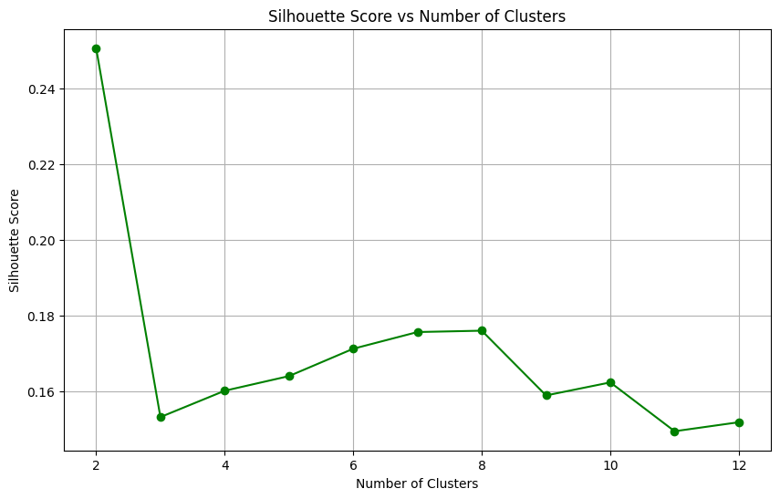
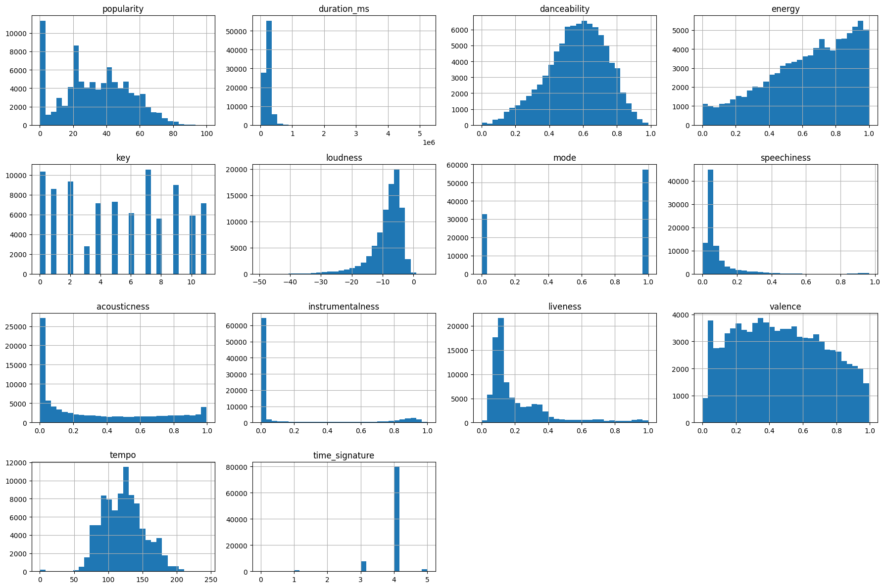
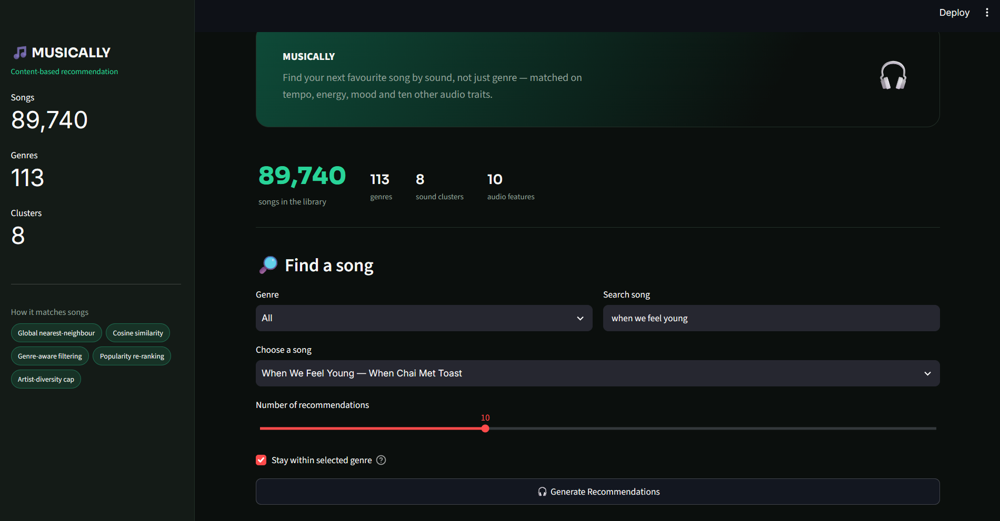
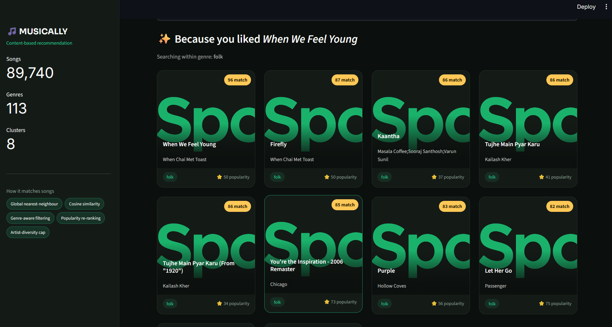

# 🎵 MUSICALLY — Content-Based Music Recommendation & Retrieval-Strategy Evaluation

A Streamlit app that recommends songs from **audio characteristics**
(danceability, energy, acousticness, valence, tempo, etc.) rather than genre
labels or listening history, matched with cosine similarity over ~81,000 unique
Spotify tracks.

It started as a single-strategy recommender. It is now also a small
**evaluation tool**: five retrieval strategies can be run on the same query,
evaluators vote 👍/👎 on each result, the votes are stored in Supabase, and the
votes are used both to *compare* the strategies and to *re-rank* future results.

---

## How It Works

1. **Clean** the raw Spotify dataset: drop nulls, drop repeated track IDs, then
   keep **one row per (track name, artist)** — the most popular copy — because
   the dump lists the same song several times (album / single / compilation
   re-releases). ~81k unique songs remain.
2. **Scale** 10 continuous audio features with `StandardScaler`.
3. **Cluster** songs into 8 groups with `KMeans` (used for EDA, and as the
   candidate pool of the `kmeans_restricted` and `hybrid` strategies).
4. **Retrieve**: the chosen *strategy* decides which songs are candidates
   (whole catalogue, same genre, same cluster, ...), cosine similarity is
   computed against that pool, and the results are ranked.
5. **Collect feedback**: 👍/👎 per result goes to Supabase and feeds back into
   ranking and into the per-strategy comparison.

```
query song → strategy picks candidate pool → cosine similarity → rank
           → remove copies/covers of the query + cap songs per artist → top-N
           → 👍/👎 → Supabase → comparison table + re-ranking
```

---

## Reading a result card

| On the card | What it is |
|---|---|
| **% sound match** | Cosine similarity between the audio features of your song and this song, as a percentage. It is *pure audio closeness* and nothing else. |
| **⭐ popularity** | Spotify's own 0–100 popularity score for the track (from the dataset, based on how much it is played). It is not computed by this app. |

The **order** of the cards is not just the sound match. Each candidate is
ranked by:

```
score = (1 − pop_w − fb_w) · similarity
        + pop_w · popularity (scaled 0..1 inside the candidate pool)
        + fb_w  · model/heuristic feedback score
        + 0.10  · query-specific feedback score
```

Defaults: `pop_w = 0.10`, `fb_w = 0.05`. The `popularity_weighted` strategy
raises `pop_w` to 0.45. Switching **Use feedback re-ranking** off removes the
two feedback terms.

> Earlier versions printed this blended score under the label "match", which
> made it look like a similarity percentage. The card now shows the pure
> similarity as "sound match" and the app explains the ranking under the title.

---

## The 5 retrieval strategies

| Strategy | Candidate pool |
|---|---|
| `global_cosine` | The whole catalogue |
| `genre_filtered` | Songs with the same `track_genre` as the query song |
| `kmeans_restricted` | Songs in the same KMeans cluster as the query song |
| `popularity_weighted` | The whole catalogue, but popularity weighs 0.45 instead of 0.10 |
| `hybrid` | Songs matching **both** the genre and the cluster |

Ranking is identical across strategies, so a comparison is about *which songs
are considered*, not about five different formulas. A pool with fewer than 5
songs falls back to the whole catalogue.

---

## How feedback is used

1. **Strategy comparison.** The "Aggregate relevance" table shows, per strategy,
   how many results were marked relevant.
2. **Query-specific memory.** For the *same query song*, a result that earlier
   evaluators marked 👍 moves up and one marked 👎 moves down
   (`(2·relevant − n) / (n + 1)`, weight 0.10 — one vote counts less than
   several agreeing votes). This is the part that visibly changes the list.
3. **Learned re-ranker** (`utils/reranker.py`). With 50+ unique labelled votes
   and both classes present, a logistic regression on the 10 audio features
   adds a small nudge (weight 0.05). Below that, a simple per-song relevance
   rate is used. It learns *audio taste in general*; it does not know which
   query a song was recommended for — that is what item 2 covers.
4. **Repeated votes count once.** Several votes on the same
   (query, strategy, song) are collapsed to the majority vote, so clicking
   the same button 14 times is one judgement, not 14.
5. **Clean comparison.** Votes cast with feedback re-ranking ON are stored as
   `<strategy>+feedback`, so they never mix with the plain strategy numbers.

---

## Model Fix #1 — Why `key`, `mode`, `time_signature` Were Dropped

The first version of this model fed **13** features into the scaler,
including `key` (a 12-value pitch class), `mode` (major/minor), and
`time_signature`. These are categorical, not continuous — but treated
as numbers, they carried as much variance as real perceptual features
like danceability or energy. The result: songs matched because they
shared a key or time signature, not because they sounded alike,
producing genre- and language-incoherent recommendations at inflated
similarity scores (95%+ across completely different genres).

Dropping those 3 features and re-clustering fixed it. Re-running the
elbow/silhouette analysis on the corrected feature set also changed the
optimal cluster count from **10 → 8**:



---

## Model Fix #2 — Retiring the KMeans Hard-Cluster Gate

The original recommender found a song's KMeans cluster and only ever
searched *inside* that cluster. With just 8 clusters covering the catalogue
across 113 genres, a cluster turned out to be a rough audio neighbourhood,
not a genre — so a song like *Believer* pulled recommendations from Bach,
bluegrass, jazz, and tango, and an Indian track pulled Russian, Chinese, and
Brazilian songs alongside sensible ones. Restricting a query to its own genre
fixed this immediately, which pointed at the real problem: the hard cluster
boundary, not a lack of "accuracy."

KMeans therefore stopped being an always-on gate. It is now only one of five
*strategies being compared*, and the first evaluation round backs the decision
up: `kmeans_restricted` had the lowest relevance rate (see `docs/05_final_report.md`).

---

## Fix #3 — Duplicate songs

The dataset repeats the same song under different track IDs. De-duplicating by
track ID alone still left ~8,400 extra copies of songs, so the search box
listed "Blinding Lights — The Weeknd" five times, and the query song's own
other copies could appear among its recommendations.

Fixed in two places: one row per (track name, artist) at load time, and at
recommendation time the query's own title (copies, covers, remixes, "- Remastered"
versions) is never recommended and near-identical titles are shown once.

## Fix #4 — Feedback buttons had no visible effect

See *How feedback is used* above. The earlier design gave feedback a 5% weight
and, once the learned model was active, ignored what was voted for that
specific query. Repeated votes were also counted as independent evidence.

---

## Exploratory Data Analysis

Distribution of the raw audio features before scaling:



Clusters projected into 2D with PCA — the 8 clusters separate into
clearly distinct regions of "sound space":


---

## App in Action




---

## Tech Stack

| Layer | Tool |
|---|---|
| UI | Streamlit |
| Clustering | scikit-learn (`KMeans`) |
| Similarity | scikit-learn (`cosine_similarity`) |
| Scaling | scikit-learn (`StandardScaler`) |
| Learned re-ranker | scikit-learn (`LogisticRegression`) |
| Feedback storage | Supabase (hosted Postgres) via `supabase-py` |
| Album art | Spotify Web API via `spotipy` |
| Data | [Spotify Tracks Dataset](https://www.kaggle.com/datasets/maharshipandya/-spotify-tracks-dataset) (Kaggle) |

---

## Project Structure

```
spotify_music_recommendation/
├── app.py                     # Streamlit UI, strategies, ranking
├── music_recommendation.ipynb # Pipeline: EDA → cleaning → clustering → model export
├── requirements.txt           # includes supabase
├── spotify_api.py             # album covers
│
├── dataset/
│   ├── spotify_clustered_dataset.csv
│   └── dataset.csv
│
├── models/
│   ├── scaler.joblib
│   └── kmeans.joblib
│
├── utils/
│   ├── feedback.py            # Supabase logging / loading / relevance rate
│   └── reranker.py            # learned feedback re-ranker (50+ votes)
│
├── docs/                      # use case, PRD, solution, feedback, final report
└── screenshots/
```

### Secrets

Nothing secret is stored in code. Streamlit secrets hold the keys:

```toml
# .streamlit/secrets.toml  (kept out of git)
SPOTIFY_CLIENT_ID = "your-client-id"
SPOTIFY_CLIENT_SECRET = "your-client-secret"
SUPABASE_URL = "https://<project>.supabase.co"
SUPABASE_KEY = "your-anon-key"
```

On Streamlit Community Cloud the same four keys go under **Settings → Secrets**.
If a secret is ever exposed, regenerate it instead of reusing it. Free Supabase
projects are paused after a period of inactivity — restore the project from the
Supabase dashboard if the app reports it cannot reach the database.

The `feedback` table needs columns `id, query_song, strategy, recommended_song,
vote, evaluator, created_at`, with `vote` restricted to `relevant` or
`not_relevant`, and row-level-security policies that allow insert and select.

---

## Running Locally

```bash
pip install -r requirements.txt
mkdir .streamlit   # then add the four keys above to .streamlit/secrets.toml
streamlit run app.py
```

## Deploying

1. Push the repo to GitHub (`.streamlit/secrets.toml` must **not** be committed).
2. On [share.streamlit.io](https://share.streamlit.io), create an app from the
   repo, branch `main`, main file `app.py`.
3. Under **Advanced settings → Secrets**, paste the four keys.
4. Deploy and share the `https://<your-app>.streamlit.app` URL.

---

## Future Improvements

- Fixed set of 5–10 seed songs and more evaluators, so strategy comparisons are
  repeatable and not one person's taste.
- Show the strategy comparison with a confidence range, not just a rate.
- Make the learned re-ranker query-aware (feed in how the recommended song
  differs from the query song, not only the recommended song's features).
- Offline metrics (genre consistency, artist diversity, Precision@K) next to
  human ratings.
- For a catalogue far beyond ~81k songs: replace brute-force cosine with an
  approximate nearest-neighbour index (FAISS, or pgvector in Postgres).

---

Built using Streamlit • Cosine similarity • Supabase • Spotify API
Developed by **Anshika Jain**
