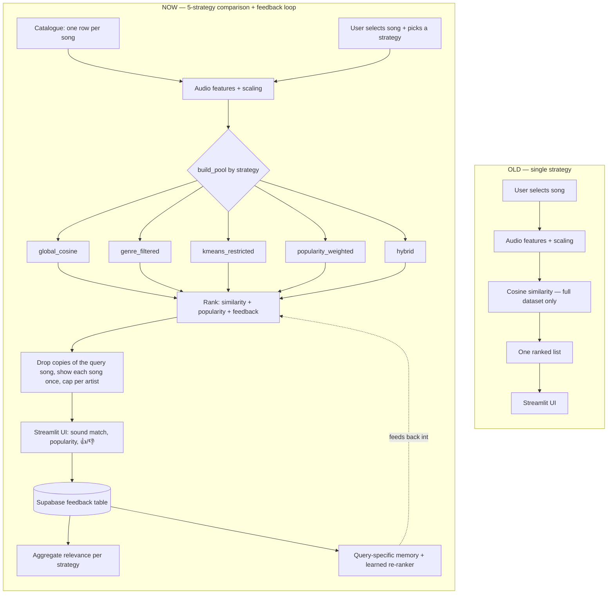

# MUSICALLY — Use Case: Recommendation Strategy Evaluation

**Project:** MUSICALLY — Content-Based Music Recommendation System
**Document purpose:** Full record of turning a single-strategy recommender
into a retrieval-strategy evaluation tool — the trigger, the PRD cycle,
what was actually built, the bugs found and fixed along the way, and the feedback loop now driving what gets built next.

> This document reflects the **current, deployed state** of the project,
> not a plan. Every claim below is either live in the app or explicitly
> marked as not yet reached.

---

## 1. Trigger — Why This Change Was Needed

The original MUSICALLY was a working content-based recommender: audio
features from a public Kaggle dataset (~81k unique real Spotify tracks, not
synthetic data — see note below) scaled and compared with cosine
similarity, with KMeans used for exploratory clustering only, served
through a Streamlit app.

Two review points converged to trigger this change:

1. **Positioning gap.** Framed as a consumer product, the obvious question
   is "why use this instead of Spotify?" — and with ~81k tracks and no
   licensing or infrastructure behind it, there's no honest answer. The
   system's real strength is that its retrieval logic is transparent and
   swappable — exactly what a team deciding *how* to build a recommender
   at scale needs to test before committing engineering time.

2. **No evidence behind any one strategy.** Only one retrieval approach was
   implemented, with no mechanism to check whether it was actually the
   best option available.

Both are solved by the same change: repurpose MUSICALLY into a
**strategy evaluation tool** — multiple retrieval strategies run against
the same queries, compared using real evaluator feedback, generating
evidence instead of guesswork.

**Note on the dataset:** this is the public Kaggle "114k Spotify Tracks"
dataset — real audio-feature values (danceability, energy, valence, etc.)
for real, named tracks, pulled from Spotify's now-deprecated Audio
Features API before it shut down for new apps in Nov 2024. It is **not**
synthetic/fake data. It's a fixed subset (114 genres × 1,000 tracks) rather
than Spotify's full catalog — that's the actual scale limitation, and it's a
licensing/availability limit, not a data-quality one.

**Catalogue size, stated precisely:** 114,000 raw rows → ~89,700 after removing
repeated track IDs → **~81,300 unique songs** after keeping one copy per
(track name, artist). Until the Oct 2026 review round the deployed app only did
the first reduction and displayed 89,740 songs while these docs said ~81k;
see §4 item 5.

---

## 2. Pipeline: Before → Now

| Aspect | Old pipeline | Current pipeline |
|---|---|---|
| Strategies | One (global cosine, KMeans for analysis only) | Five: `global_cosine`, `genre_filtered`, `kmeans_restricted`, `popularity_weighted`, `hybrid` |
| Strategy selection | N/A | Sidebar dropdown; every vote tagged with the strategy active when it was cast |
| Catalogue | Repeated songs (one song under several track IDs) | One row per (track name, artist) |
| Result card | "match" = blended ranking score | **sound match** = pure audio similarity; popularity shown separately; ranking formula explained in the app |
| Feedback | None captured | Per-result 👍/👎, logged with `query_song, strategy, recommended_song, vote, evaluator, created_at` |
| Feedback storage | N/A | Supabase (hosted Postgres) — survives app restarts/redeploys |
| Evaluator identity | N/A | Auto-generated per-session ID (see §4 item 3) |
| Using the feedback | N/A | (a) aggregate relevance-rate table per strategy, (b) **query-specific memory** that visibly moves 👍 songs up and 👎 songs down for that query, (c) learned re-ranker once 50+ unique votes exist |
| Repeated votes | N/A | Several votes on the same (query, strategy, song) count as one judgement |
| Clean evaluation | N/A | "Use feedback re-ranking" toggle; votes cast with it ON are tagged `<strategy>+feedback` |
| What it proves | That a recommendation can be generated | Which retrieval approach evaluators actually rate higher, with evidence |

---

## 3. The Complete PRD Cycle

**Client / Team → Requirements** — the trigger above was raised before any
code changed (see `06_feature_cycle_walkthrough.md`).

**Requirements → PRD** (`02_prd.md`) — target user redefined as "a team
building a music platform," functional requirements written around
running multiple strategies, per-result feedback, and aggregate reporting.

**PRD → Solutioning** (`03_solution.md`) — architecture diagrammed, all 5
strategies tabulated with what candidate pool each searches, and real
implementation decisions worked through as Problem → Options → Trade-offs →
Decision, including the review-round fixes.

**Solutioning → Implementation** — all 5 strategies are live; feedback logging
is Supabase-backed; the learned re-ranker and the query-specific feedback
memory are implemented.

**Implementation → Prototype → User Testing** — the app is deployed. A first
evaluation round of **80 votes** (4 query songs × 5 strategies, cast by one
evaluator) produced the first strategy comparison (`05_final_report.md` §9);
further testing continued to 110 raw votes. Testing is ongoing, not finished.

**User Testing → Feedback → Analyze → New Version** — the mentor review of the
live app found four problems (§4, "Review round"); each was traced to a root
cause and fixed. The next version is the current one.

---

## 4. What Actually Got Built (and what broke, and got fixed)

This section exists because the honest version of "what I did" includes
the mistakes caught along the way, not just the final code.

1. **5 retrieval strategies**, dispatched from one `build_pool(selected_row, strategy)`
   function in `app.py` rather than 5 separate strategy files as originally
   planned — with only 5 strategies and shared ranking logic, one function
   with clear branches was simpler to maintain than a `strategies/` package,
   without losing pluggability.

2. **Feedback storage: local CSV → Supabase.** The first working version
   logged votes to a CSV file. That was flagged honestly to the mentor
   before it became a problem: Streamlit Community Cloud's filesystem is
   ephemeral, so a CSV would silently lose every vote on redeploy/restart.

3. **Bug found after deploying the Supabase migration:** every vote was
   logged with the same evaluator value, `evaluator_01` — a sidebar text
   input with that string hardcoded as its default. Fixed by generating a
   random per-session ID (`uuid`) automatically.

4. **Learned re-ranker (`utils/reranker.py`).** Replaced a hand-guessed
   feedback weight with a logistic regression trained on real votes, gated
   behind 50+ labelled votes with both 👍 and 👎 present. Below that the
   original heuristic is used.

### Review round (Oct 2026) — three things the mentor flagged

After reviewing the live app the mentor was unhappy with three things. Each is
below with where the system was lagging, the root cause, and the fix.

5. **Duplicates in search and results.**
   *Lagging:* the search box listed the same song up to 5–6 times; the results
   could contain the query song itself and copies/covers of it.
   *Root cause:* the dataset stores one song under several track IDs
   (re-releases). Cleaning removed repeated **track IDs** only, so ~8,400
   songs still existed more than once. The recommender skipped only the query's
   own *row*, and de-duplicated results only on the exact (name, artist)
   string — so other copies, covers and "- Remastered"/"(Remix)" variants got
   through. (Found by checking the live search list and by running the
   recommender on "Blinding Lights": the query song came back as its own
   3rd recommendation.)
   *Fix:* one row per (track name, artist), keeping the most popular copy; at
   ranking time the query's own title is never recommended and near-identical
   titles are shown once. The app now reports ~81k songs, matching these docs.

6. **Feedback buttons did not visibly change anything.**
   *Lagging:* ~13 👍 votes on one song for one query left the results the same.
   *Root causes (three):* (a) feedback carried only 5% of the ranking weight,
   while the top results differed by about 1% — too small to be noticed;
   (b) once the learned model was active it replaced the per-song history
   completely, and the model only sees the *recommended song's* audio
   features, not which query it was recommended for — so 14 votes on one song
   taught it "songs that sound like this are fine", not "recommend this song
   for this query"; (c) repeated votes on the same song counted as 14
   independent pieces of evidence, which also inflated that strategy's
   relevance rate.
   *Fix:* a **query-specific memory** (👍 songs for this exact query move up,
   👎 songs move down; weight 0.10, shrunk by vote count); repeated votes on the
   same (query, strategy, song) collapse to one judgement; the learned model
   stays as a small second signal. Verified on the live data shape: a 👍 song
   moved from rank 5 to rank 1 and a 👎 song left the top 10.

7. **The "match score" was not understandable.**
   *Lagging:* the card said "88 match" with no explanation, and the number was
   not what it appeared to be.
   *Root cause:* it was the final **blended ranking score** (85% similarity +
   10% popularity + 5% feedback), not a similarity percentage. Popularity (the
   ⭐ number) is Spotify's own 0–100 score and was never explained either.
   *Fix:* the card shows **"N% sound match"** = pure cosine similarity,
   popularity stays a separate labelled number, and a caption under the
   strategy states the ranking formula.

8. **A methodology safeguard added because of #6:** because feedback now
   changes rankings, evaluating strategies *with* feedback on would inflate
   their relevance rates. A **"Use feedback re-ranking" toggle** was added, and
   votes cast with it ON are stored as `<strategy>+feedback`, so the clean
   strategy comparison is never mixed with feedback-influenced runs.

---

## 5. Loop Back — How Feedback Re-enters the Cycle

- More evaluators and fixed seed songs → the strategy comparison in
  `05_final_report.md` moves from "first signal" to evidence.
- Comparing `<strategy>` with `<strategy>+feedback` rows shows whether
  feedback re-ranking actually raises the relevance rate.
- Once the learned re-ranker has enough varied data, its learned feature
  weights become a finding in their own right.
- If results are close/inconclusive → a new candidate strategy is added
  and the comparison repeats.
- Every decision — including the ones that turned out to be wrong first
  (CSV storage, the evaluator-ID bug, duplicates, weak feedback) — is logged,
  not hidden.

---

*Supporting documents: `01_problem_statement.md`, `02_prd.md`,
`03_solution.md`, `04_user_feedback.md`, `05_final_report.md`,
`06_feature_cycle_walkthrough.md`.*
