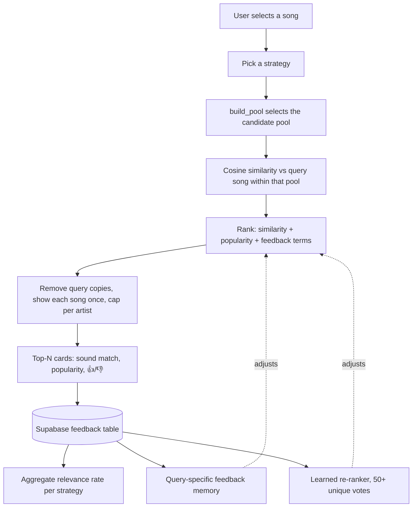

# 03 — Solution

This is the "how I thought about it before/while building it" document.
Every decision below is a real one made during this project, including the
ones that had to be reversed after being caught in testing or review.

## Architecture (current, deployed)



KMeans is fit once during preprocessing and stored as a `cluster` column
in the dataset — it's used for the `kmeans_restricted`/`hybrid`
strategies' pool selection and for exploratory analysis, not as an
always-on gate the way the very first version used it.

## Strategies under comparison

| Strategy | Candidate pool | Status |
|---|---|---|
| `global_cosine` | Full dataset | Implemented |
| `genre_filtered` | Songs sharing the query song's `track_genre` | Implemented |
| `kmeans_restricted` | Songs sharing the query song's KMeans `cluster` | Implemented |
| `popularity_weighted` | Full dataset, but `popularity_weight` raised to 0.45 (from the default 0.10) so ranking — not just pool — differs meaningfully | Implemented |
| `hybrid` | Songs matching **both** genre and cluster | Implemented |

Ranking math is identical across all 5 strategies — only the candidate pool
(and, for `popularity_weighted`, one ranking weight) differs. This is
deliberate: it keeps the comparison about pool selection, not about five
different scoring formulas.

A pool smaller than 5 songs (can happen for `kmeans_restricted`/`hybrid`
on a rare cluster+genre combination) falls back to the full dataset
rather than returning a near-empty result.

## How a result is scored (and what the card shows)

```
score = (1 − pop_w − fb_w) · similarity
        + pop_w · popularity_scaled
        + fb_w  · general_feedback_score
        + 0.10  · query_feedback_score
```

| Term | Meaning | Default weight |
|---|---|---|
| `similarity` | Cosine similarity of the 10 scaled audio features. **This is the "sound match" % on the card.** | 1 − pop_w − fb_w = 0.85 |
| `popularity_scaled` | Spotify's own 0–100 popularity, rescaled 0..1 inside the candidate pool | `pop_w` = 0.10 (0.45 for `popularity_weighted`) |
| `general_feedback_score` | Learned model's P(relevant) − 0.5 once 50+ unique labelled votes exist; otherwise the song's own historical relevance rate − 0.5 | `fb_w` = 0.05 |
| `query_feedback_score` | For this exact query song: (2·relevant − n) / (n + 1) over past judgements of this recommended song, in (−1, 1) | 0.10 |

With "Use feedback re-ranking" switched off, the last two terms are zero.
Top candidates usually differ by about 0.01 in score, which is why a weight of
0.05 was invisible and 0.10 on the query-specific term is clearly visible.

## Decision log
_(Real issues hit during this project, in the order they came up.)_

### Issue: One strategy, no way to compare
**Problem:** Only global cosine similarity was implemented; no evidence
existed for whether it was actually the best available approach.
**Options:**
- A — Keep one strategy, trust intuition
- B — Add strategies as separate files in a `strategies/` package
- C — Add strategies as branches in one `build_pool(selected_row, strategy)`
  dispatcher function inside `app.py`
**Decision:** C.
**Reason:** With exactly 5 strategies sharing all of their ranking logic
and most of their pool-selection logic, a `strategies/` package would have
meant 5 files that mostly duplicate the same code, with only the pool-filter
line differing. One function with 5 clear branches was simpler to read, test,
and extend. **This changed from what `02_prd.md`/`06_feature_cycle_walkthrough.md`
originally proposed** — noted here rather than silently diverging.

### Issue: Feedback storage was local CSV
**Problem:** The first working version wrote votes to a CSV file.
Streamlit Community Cloud's filesystem is ephemeral — any restart or
redeploy would silently wipe every recorded vote.
**Options:** A — keep the CSV; B — Supabase (hosted Postgres); C — SQLite
(still local to the container, same problem).
**Decision:** B.
**Reason:** Only Supabase survives redeploys. `utils/feedback.py` keeps the
same public functions, so `app.py` needed no changes to its calling code.
**Caught how:** flagged before it caused data loss, once the
ephemeral-filesystem behaviour was understood.
**Operational note:** a free Supabase project is paused/removed after a period
of inactivity; when that happened the live app could not reach the database
and had to be restored from the Supabase dashboard.

### Issue: Every evaluator's vote was logged identically
**Problem:** Every row in the feedback table had `evaluator_01`.
**Root cause:** a sidebar `st.text_input` had that value hardcoded as its
default, and nothing prompted anyone to change it.
**Options:** A — ask each evaluator to type a name; B — auto-generate a
random ID per browser session (`uuid`).
**Decision:** B, for now.
**Reason:** removes the failure mode entirely, at the cost of identifying a
*session*, not a *person* (see `04_user_feedback.md` §9).
**Caught how:** checked the Supabase table directly after deploying and saw
every row identical.

### Issue: The feedback boost weight was a guess
**Problem:** the boost used a hand-picked constant (`feedback_weight=0.05`).
**Decision:** replace it with a logistic regression on real feedback
(`utils/reranker.py`), gated at 50+ labelled votes with both classes present;
below that the original heuristic remains. See the next two issues for what
this design got wrong.

### Issue: Duplicate songs (mentor review)
**Problem:** the search list showed the same song up to 5–6 times, and the
query song (or a copy of it) could appear in its own recommendations.
**Root cause:** the raw dataset holds a song once per release (album, single,
compilation) under different track IDs. Cleaning removed repeated track IDs
only; about 8,400 songs were still present more than once. The recommender
skipped only the query's own row and de-duplicated on the exact
(name, artist) text, so other copies, covers and "- Remastered"/"(Remix)"
variants passed.
**Options:** A — only filter at recommendation time; B — only de-duplicate the
catalogue; C — both.
**Decision:** C.
**Reason:** the catalogue fix removes exact repeats everywhere (search list,
counts, feedback labels, which must be unique to be matched back to a song);
the ranking-time rule handles what a data fix cannot — covers and variants by
other artists, and never recommending the query song back to itself.
**Caught how:** the mentor noticed it in the live app; reproduced by running
"Blinding Lights" through the recommender and finding the query song as its
own third result. The docs had said "~81k unique" while the app displayed
89,740 — the docs described the intended state, not the deployed one.

### Issue: Feedback buttons showed no visible effect (mentor review)
**Problem:** ~13 👍 votes on one recommended song for one query did not change
the list the next time.
**Root causes:**
1. Weight too small — feedback carried 5% of the score while top results
   differed by ~1%.
2. The learned model sees only the recommended song's audio features. It does
   not know *which query* the song was recommended for, and when it was active
   it replaced the per-song history. So the 14 votes became one data point
   repeated 14 times.
3. Repeated votes counted as independent evidence — which also pushed up the
   relevance rate of the strategy those votes were cast under.
**Options:** A — raise `feedback_weight`; B — make the model query-aware
(feed in query-vs-song differences); C — add a query-specific memory alongside
the model, and collapse repeated votes.
**Decision:** C now, B listed as future work.
**Reason:** C is simple to explain ("for this song, what did people say about
these recommendations?"), shows an effect immediately, and works with a handful
of votes where a query-aware model would not have enough data. A alone would
have made the generic model louder without fixing what it can't know.
**Verified:** on test data a 👍 song moved from rank 5 to rank 1, a 👎 song
left the top 10, three repeated clicks counted once.

### Issue: Match score was not understandable (mentor review)
**Problem:** the card said "88 match" and nobody could say what it measured.
**Root cause:** it was the final ranking score ×100 — a blend of similarity,
popularity and feedback — labelled as if it were similarity. Popularity (⭐)
was a Spotify number that was never explained either.
**Decision:** show **pure cosine similarity** as "N% sound match", keep
popularity separate and labelled, and print the ranking formula under the
strategy name.
**Reason:** a number on screen should mean one thing. The ranking order can
legitimately differ from the sound-match order, and now the app says so.

### Issue: Feedback re-ranking would contaminate the strategy comparison
**Problem:** once feedback changes rankings, results shown to later evaluators
are already shaped by earlier votes, so a strategy's relevance rate drifts up
for reasons unrelated to the strategy.
**Options:** A — always on and accept it; B — always off; C — a toggle, with
votes tagged by mode.
**Decision:** C. "Use feedback re-ranking" defaults to ON (it is the feature
being demonstrated); votes cast with it ON are stored as `<strategy>+feedback`.
**Reason:** keeps the clean strategy comparison clean, and makes
"does feedback re-ranking raise relevance?" a measurable question —
compare `<strategy>` rows with `<strategy>+feedback` rows.
