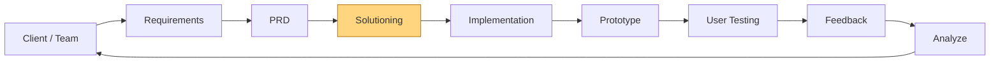

# 06 — Feature Addition Cycle: From One Strategy to a Learned Feedback Loop

This doc walks through the full, real cycle for this project — not just
the final code, but the order things actually happened in, including the
points where testing or review caught something wrong and it had to be fixed.

*(`PRD` and `Solutioning` were revisited more than once as real issues
came up mid-implementation and after the mentor review — the loop above isn't
strictly one-pass, and §3–§5 below show where that happened.)*

---

## 1. Trigger — what started this

The live app ran exactly one retrieval strategy (global cosine
similarity, with KMeans used only for exploratory clustering). There was
no way to check whether a different approach — genre-restricted,
cluster-restricted, popularity-weighted, or some hybrid — would actually
surface more relevant songs. Decisions about what to build next were
being made on intuition, not evidence.

## 2. Communicating it to the team before building anything

> **Requirement:** We need evidence on which retrieval strategy actually
> returns more relevant songs, before committing to one.
>
> **Current:** Only global cosine similarity is live. No comparison, no
> feedback capture exists.
>
> **Problem:** We can't validate which approach is better without a
> structured way to record evaluator judgment.
>
> **Alternative:** Add a strategy picker with several retrieval modes, let
> an evaluator vote relevant/not-relevant per result, and store that
> feedback somewhere durable.
>
> **Trade-off:** More UI and more branching logic per query, but it avoids
> locking in a strategy before there's any evidence behind it.
>
> **Recommendation:** Build it directly in the live Streamlit app, with
> feedback logged to a real, persistent store (not a fragile local file) —
> cheap enough to build now, real enough to trust the results.

## 3. What was planned vs. what was actually built

The original PRD/solutioning drafts proposed a `strategies/` package —
one file per strategy, each a standalone function. During implementation
this was simplified to a single `build_pool(selected_row, strategy)`
dispatcher inside `app.py`, once it was clear all 5 strategies share
identical ranking logic and differ only in which candidate pool they
search. This is flagged explicitly in `03_solution.md`'s decision log —
the plan changed once the implementation made the original plan look like
unnecessary duplication, and that's recorded rather than quietly ignored.

## 4. Building it — in the order it actually happened

1. **Refactored the single `recommend()` into `build_pool()` + `recommend(strategy=...)`**,
   with 5 strategies: `global_cosine`, `genre_filtered`, `kmeans_restricted`,
   `popularity_weighted`, `hybrid`.
2. **Added the strategy picker** to the sidebar, and tagged every vote
   with whichever strategy was active at search time.
3. **Added feedback logging** — 👍/👎 per result, first version wrote to a
   local CSV.
4. **Caught a storage bug before it caused data loss:** Streamlit
   Community Cloud's filesystem is ephemeral — a CSV would be silently
   wiped on every restart/redeploy. Migrated feedback storage to Supabase
   (hosted Postgres), keeping `utils/feedback.py`'s public functions
   unchanged. Deployment then needed debugging (a missing package and
   missing secrets on Streamlit Cloud), and later a paused free Supabase
   project had to be restored.
5. **Caught a real bug after deploying the migration:** checked the live
   Supabase table directly and found every row logged with the identical
   evaluator value, `evaluator_01` — a hardcoded default on a sidebar text
   input. Fixed by auto-generating a random per-session ID instead.
6. **Asked the harder question: what's the point of collecting feedback
   at all, beyond a display table?** This led to `utils/reranker.py` — a
   logistic regression trained on real feedback that replaces the original
   hand-guessed `feedback_weight=0.05`, gated at 50 labelled votes.
7. **First evaluation round:** 80 votes over 4 seed songs and all 5
   strategies. Result: genre-based strategies `hybrid` (13/13) and
   `genre_filtered` (18/19) were judged relevant far more often than
   `popularity_weighted` (5/16), `global_cosine` (4/17) and
   `kmeans_restricted` (1/15). Treated as early signal, not a verdict.
8. **Mentor review of the live app — four problems:**
   - **Duplicates.** The search list repeated songs and a song could be
     recommended back to itself. Cause: the dataset keeps one song per
     release under different track IDs, and cleaning only removed repeated
     IDs. Fixed with one row per (track, artist) plus ranking-time rules.
   - **Feedback buttons did nothing visible.** ~13 👍 on one song changed
     nothing. Causes: weight far smaller than the score spread; the learned
     model ignored which query a song was recommended for; repeated votes
     counted as many. Fixed with a query-specific memory, collapsing repeated
     votes, and keeping the model as a small extra.
   - **Match score unclear.** It was the blended ranking score labelled like a
     similarity. Now "N% sound match" (pure similarity), popularity labelled
     separately, formula shown.
   - **Documents out of date.** Rewritten to match the code and the data.
9. **Methodology safeguard that came out of #8:** because feedback now changes
   rankings, a "Use feedback re-ranking" toggle was added and votes cast with it
   ON are stored as `<strategy>+feedback`, so clean strategy numbers stay clean.

## 5. Where I changed my mind, and where a suggestion turned out wrong

**1. I treated categorical features as numbers (the earliest mistake).**
My first model fed 13 audio features into the scaler, including `key`
(a pitch class from 0 to 11), `mode` (major or minor) and `time_signature`.
I accepted them because they are stored as numbers. But a key of 11 is not
"more" than a key of 1, and mode is a yes/no. Scaled and fed into cosine
similarity, these three columns carried as much weight as danceability or
energy. The symptom was recommendations that matched on key and time signature
instead of sound — 95%+ similarity between completely different genres.I dropped the three columns, re-ran the
elbow/silhouette analysis, and the best cluster count moved from 10 to 8.
*Lesson: a column being a number does not mean it behaves like one, and a
surprisingly high similarity is a reason to be suspicious, not pleased.*

**2. I trusted the KMeans cluster as a gate.**
The recommender only searched inside a song's cluster. With 8 clusters over 113
genres, a cluster was a rough audio neighbourhood, not a genre. Restricting a
query to its own genre fixed the results immediately, which told me the real
problem was the hard boundary, not "accuracy". My own votes later agreed:
`kmeans_restricted` had the lowest relevance rate (1 of 15).

**3. I assumed things worked without checking the live system.**
The first feedback store was a CSV; on Streamlit Cloud it would silently lose
every vote on redeploy, so I moved to Supabase before any data was lost. After
deploying, every row said `evaluator_01` — I only saw it by opening the
Supabase table, and the cause was a hardcoded default in the sidebar. I also
dropped the planned `strategies/` package for one `build_pool()` function once I
saw five files would mostly duplicate each other.

**4. Two mistakes in the review round.**
- *Wrong diagnosis.* When the strategies looked identical I blamed the small
  dataset and started asking about bigger ones. Running the strategies on the
  real data showed they were different; the deployed app was still running the
  old code. Checking first saved me from fixing the wrong thing.
- *"Active" is not "working".* I built the learned re-ranker, saw "active,
  trained on 110 votes", and treated it as done. I had checked that it ran, not
  that a 👍 visibly changed anything. When my mentor voted 👍 about 13 times on
  one song and nothing moved, it exposed three flaws: the weight was tiny, the
  model never saw which query a song belonged to, and repeated votes counted as
  many. The re-ranker design I accepted from AI assistance had that blind spot
  from the start, and I had not tested the behaviour a user would expect.
  The same pattern showed in the docs: they said ~81k songs while the app
  showed 89,740 duplicates-included, because I wrote them from the plan, not
  from the running app.

**What I do differently now.** I check what the user would actually see, not
only that the code runs. I read the live data (the Supabase table, the search
list, the counts) before trusting a number. I treat a result that is
suspiciously good, or suspiciously identical, as a prompt to investigate. And I
write documentation from the running system.

## 6. Where this loops back

- The aggregate relevance table (`04_user_feedback.md` §8,
  `05_final_report.md` §9) is the first real evidence for what to build at
  scale; it needs more evaluators and a fixed seed list to become a result.
- Comparing `<strategy>` with `<strategy>+feedback` rows will show whether
  the feedback loop actually raises relevance.
- Next build candidate: a query-aware learned re-ranker.

Either way, the result gets logged in `05_final_report.md`, and the next
iteration starts from that evidence — not from scratch.
